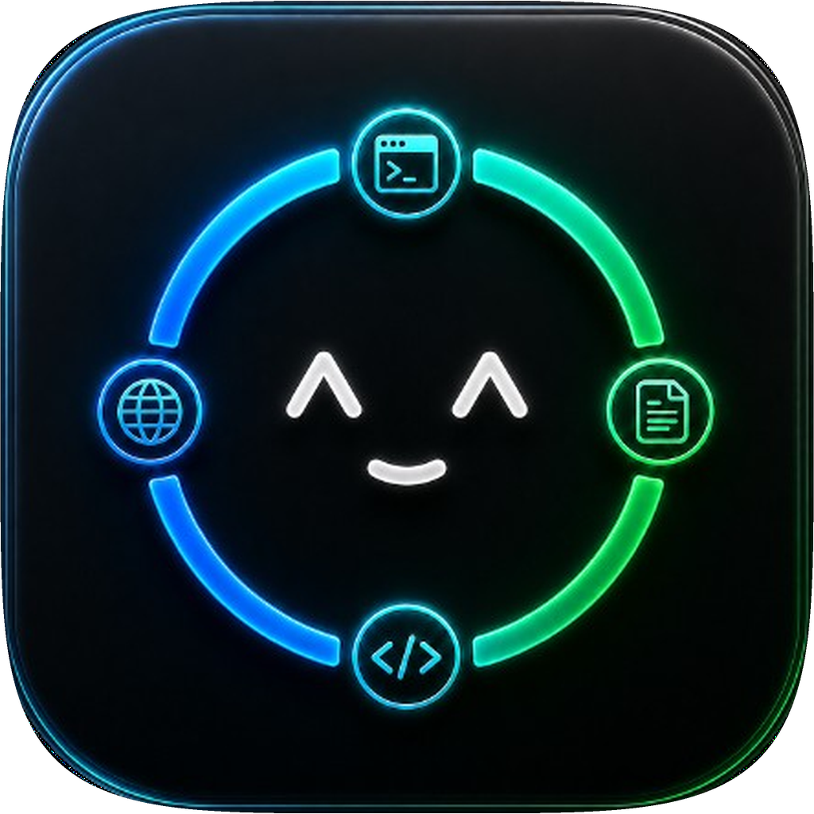
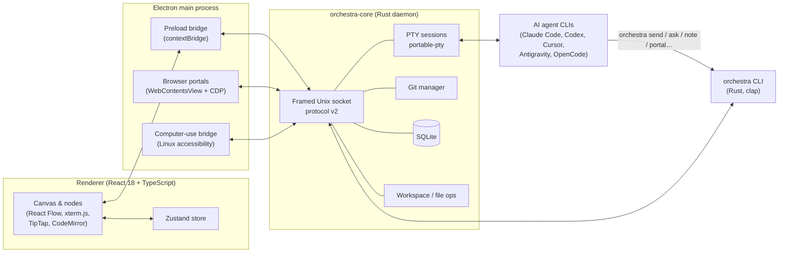

<div align="center">



# Orchestra

### The spatial agent harness for developers

**An infinite-canvas desktop workspace where AI coding agents, terminals, notes, file trees and browsers live as connected nodes — and the cables between them are the access-control graph.**

[](https://www.electronjs.org/)
[](https://react.dev/)
[](https://www.typescriptlang.org/)
[](https://www.rust-lang.org/)
[](https://sqlite.org/)
[](#installation)
[](#roadmap)

</div>

---

## Table of contents

- [What is Orchestra?](#what-is-orchestra)
- [Why an agent harness?](#why-an-agent-harness)
- [Key features](#key-features)
- [Architecture](#architecture)
- [AI agents supported](#ai-agents-supported)
- [Agent orchestration model](#agent-orchestration-model)
- [Tokens: security tokens and token economy](#tokens-security-tokens-and-token-economy)
- [Highlights worth a closer look](#highlights-worth-a-closer-look)
- [The `orchestra` CLI](#the-orchestra-cli)
- [Browser portals and computer use](#browser-portals-and-computer-use)
- [Git floors, worktrees and roles](#git-floors-worktrees-and-roles)
- [Voice input](#voice-input)
- [Data model](#data-model)
- [Tech stack](#tech-stack)
- [Repository layout](#repository-layout)
- [Getting started](#getting-started)
- [Testing and quality gates](#testing-and-quality-gates)
- [Packaging](#packaging)
- [Roadmap](#roadmap)
- [Author](#author)
- [License](#license)

---

## What is Orchestra?

**Orchestra** is a desktop application for developers who work with more than one AI coding agent at a time. Instead of juggling terminal tabs, Orchestra gives you an **infinite 2D canvas** where every piece of your working context is a *node*:

| Node | What it is |
| --- | --- |
| **Terminal** | A real PTY running a shell or an AI agent CLI (Claude Code, Codex, Cursor, Antigravity, OpenCode…) |
| **Note** | A Markdown sticky note (TipTap editor) that humans and agents can read and write |
| **File tree** | A workspace browser with list, diff, git graph and CodeMirror editor modes |
| **Browser portal** | A live Chromium view (Electron `WebContentsView`) that agents can inspect, click and screenshot |
| **Text / Shape / Drawing** | Annotation primitives for diagrams and planning |

Nodes are joined by **physical-looking cables (ropes)**. A cable is not decoration: it is a **permission edge**. An agent may only see and act on the nodes that are connected to its terminal.

> Think of it as an operating table for multi-agent software engineering: you place your agents, give them notes and files, wire up who may talk to whom, and watch the work happen on a single shared surface.

---

## Why an agent harness?

A large language model on its own can only produce text. What turns it into a *coding agent* is the **harness** around it: the program that gives the model a controlled body — a terminal to run commands, a file system to read and edit, a browser to look at pages, a memory to persist context, and rules about what it is allowed to touch.

Today, each agent CLI ships its own private harness, and they do not know about each other. Orchestra is a **harness of harnesses**:

```
┌────────────────────────────────────────────────────────────────────┐
│                          ORCHESTRA (meta-harness)                  │
│                                                                    │
│   identity & auth ─ permissions graph ─ shared notes ─ audit log   │
│                                                                    │
│  ┌────────────┐   ┌────────────┐   ┌────────────┐   ┌───────────┐  │
│  │ Claude Code│   │ Codex CLI  │   │ Cursor CLI │   │ OpenCode  │  │
│  │ (harness)  │   │ (harness)  │   │ (harness)  │   │ (harness) │  │
│  └─────┬──────┘   └─────┬──────┘   └─────┬──────┘   └─────┬─────┘  │
│        │  LLM           │  LLM           │  LLM           │  LLM   │
└────────┴────────────────┴────────────────┴────────────────┴────────┘
```

Orchestra does **not** replace those agents and does **not** call an LLM API by itself. It hosts them in real PTYs and adds what individual harnesses lack:

1. **Coordination** — agents can delegate work to each other through a typed, auditable CLI instead of fragile copy-and-paste.
2. **Scoped context** — the canvas graph defines exactly which notes, files and browsers each agent may see.
3. **Verifiable delivery** — a message written to a PTY is *not* the same as a message understood. Orchestra models that difference explicitly (see [delivery states](#delivery-states-no-false-success)).
4. **Isolation** — parallel agents get their own git worktrees ("floors") so they do not overwrite each other.
5. **Observability** — every agent request is recorded in a local audit trail.

---

## Key features

### Spatial canvas
- Infinite, zoomable, pannable canvas built on **React Flow (`@xyflow/react`)** with custom nodes.
- Physics-flavoured **cable system**: simulation, collision solver, anchor resolver and router (`components/Canvas/CableSystem`).
- Minimap, floating toolbar, command palette, light/dark theme, per-workspace icon and colour.
- Smart drawing tools (shapes, free drawing) for sketching architecture next to the agents that implement it.

### Terminals built for agents
- Real pseudo-terminals through `portable-pty` in the Rust core, rendered with **xterm.js** (WebGL renderer, Fit, Search, Serialize, Unicode 11, Web-links addons).
- **Terminal V2**: block-based command history, virtualised block list, rich command editor (CodeMirror), shell-aware completion providers, command parser and security checks.
- Bounded scrollback, PTY back-pressure handling, resize consistency between renderer, main process and PTY.
- Shell integration scripts so the app understands command boundaries.

### Connected context
- **Notes as shared memory** between humans and agents — with revision history stored in SQLite.
- **File-tree nodes** exposing a workspace root with traversal protection (paths outside the root are rejected by the daemon).
- **Git built in**: status, diff, staged diff, log, blame, stash, branches, tags, merge, rebase, cherry-pick, revert, reset and worktrees.

### Safety by construction
- Per-session **capability tokens** and a versioned wire protocol (see [Tokens](#tokens-security-tokens-and-token-economy)).
- The cable graph is the **ACL**; connection permissions are stored per edge (`read`, `write`, `append`, …).
- Typed CLI instead of raw PTY keystrokes for everything that can be expressed semantically.
- `audit_log` and `agent_request_audit` tables for post-hoc review.

---

## Architecture

Orchestra has three mandatory layers. Electron is the desktop runtime; the product logic lives in a Rust daemon.



| Layer | Responsibility |
| --- | --- |
| **Renderer** (`apps/desktop/src/renderer`) | Design, interaction, canvas, terminal UI, notes, file trees |
| **Electron main + preload** (`apps/desktop/src/main`, `src/preload`) | Windows, Chromium portals, desktop integration, a *small and restricted* bridge to the core |
| **Core daemon** (`crates/orchestra-core`) | PTYs, git, files, SQLite, auth, permissions, orchestration |
| **CLI** (`crates/orchestra-cli`) | The authenticated API that agents themselves call from inside their terminals |

Why Rust for the core? Process management, PTYs, git and long-lived state should not depend on a renderer's lifecycle. The daemon can start, restart and recover from a stale socket independently, and a second instance is refused without disturbing the first.

Why Electron and not Tauri? Browser portals must behave like real Chrome windows — isolated sessions, DOM access, console, screenshots, agent control. Electron already embeds Chromium and `WebContentsView`, which removes the biggest technical risk.

---

## AI agents supported

Orchestra launches any command-line agent. The built-in catalog includes:

| Agent | Command | Vendor / model family |
| --- | --- | --- |
| **Claude Code** | `claude` | Anthropic |
| **Codex CLI** | `codex` | OpenAI |
| **Cursor CLI** | `cursor-agent` | Cursor |
| **Antigravity CLI** | `agy` | Google Gemini |
| **OpenCode** | `opencode` | Open-source, multi-provider |
| **Zsh** | `zsh` | Plain system shell |

You can also register **custom agents** (any executable plus a list of arguments). Custom agent definitions are validated — no spaces or shell operators in the executable, no control characters, bounded argument count — and stored locally.

Because the agents are heterogeneous, Orchestra mixes **models from different vendors in the same canvas**: for instance a Claude Code agent planning, a Codex agent implementing, and an OpenCode agent reviewing — all coordinated through the same CLI and notes.

Orchestra ships its own **skill** (`skills/orchestra-canvas/SKILL.md`) and a **Codex plugin manifest** (`.agents/plugins`) that teach agents how to operate the canvas correctly: bootstrap checks, which commands to prefer, and the boundaries they must respect.

---

## Agent orchestration model

### Roles and topology

A common setup is a **coordinator** terminal wired to several **worker** terminals, a shared **spec note**, and a **file tree**:

```
            ┌───────────────┐
            │  Spec (note)  │
            └──────┬────────┘
                   │ read/write
 ┌─────────────┐   │   ┌─────────────┐
 │ Worker A    │───┴───│ Coordinator │───── Browser portal
 │ (Codex)     │       │ (Claude)    │
 └─────────────┘       └──────┬──────┘
                              │ send / ask
                       ┌──────┴──────┐
                       │  Worker B   │
                       │ (OpenCode)  │
                       └─────────────┘
```

Only connected nodes are reachable. A worker connected to the spec note but not to the browser cannot open or drive that browser.

### Mandatory bootstrap

Every agent task starts with three authenticated checks, enforced by the skill:

```bash
orchestra doctor        # protocol version + capabilities negotiated with the daemon
orchestra connections   # which nodes are wired to THIS terminal, and with which permissions
orchestra agents        # which peer agents/terminals are alive and reachable
```

All three must succeed and agree. If any fails after one retry, the agent stops and reports the exact failing command — it never borrows another session's credentials or launches a second daemon.

### Delivery states: no false success

A classic multi-agent bug is to treat "I typed it into the terminal" as "the agent did it". Orchestra separates the states explicitly:

| State | Meaning |
| --- | --- |
| `ptyWritten` | Bytes reached the peer's PTY. Nothing more. |
| `delivered` | The peer printed the request-specific completion marker. |
| `agentAcknowledged` | The peer acknowledged the request. |
| `completed` | The task finished with a verifiable response. |
| `unverified` | Timeout, cancellation or partial output — reported honestly. |

```bash
orchestra send <terminal-id> "Review the authentication module."          # fire-and-record
orchestra ask  <terminal-id> "Review the authentication module." \
               --wait --timeout-secs 90                                    # wait for completion marker
orchestra request-history                                                  # local audit of requests
```

### Prefer semantic operations over keystrokes

Large or multi-line text pushed through a TUI can be duplicated, fragmented or left unsubmitted. Orchestra's rule of thumb:

1. Use `send` / `ask` for delegation.
2. Put long context in a **connected note** and send a short reference to it.
3. Use raw `terminal type` / `terminal key` only when no semantic command exists — and then follow the observe → classify → act → verify loop (`terminal screen`, `wait-for`).

---

## Tokens: security tokens and token economy

"Tokens" mean two different things in an AI system, and Orchestra takes both seriously.

> **Orchestra does not implement an LLM tokenizer and does not call model APIs.** Text tokenization (BPE, SentencePiece, …) happens inside the agent CLIs you run. Orchestra's role is to be the **context-cost-aware layer between agents** — it decides *how much* information crosses between them — and to use **authentication tokens** so that crossing is safe.

### Why token economy matters in a multi-agent canvas

Every character an agent reads is converted into tokens that occupy its context window and are billed. In a multi-agent setup the cost compounds: a lead agent briefs three workers, each worker reports back, each report is re-read by the lead. Naïve harnesses re-paste whole files, whole pages and whole transcripts. Orchestra attacks the problem structurally:

```
  Naïve multi-agent                         Orchestra
  ───────────────────                       ──────────────────────────────
  paste 800-line brief  → worker A          write brief once into a note
  paste same brief      → worker B          "read note n_42" (1 line) → A, B
  paste raw page HTML   → agent             portal inspect: bounded text+links
  paste whole log       → agent             terminal screen --plain (tail only)
  every agent sees all  → context bloat     only connected nodes are visible
```

### Token-economy techniques implemented

| Technique | Where | Effect on context cost |
| --- | --- | --- |
| **Graph-scoped visibility** | Cable graph = ACL; `orchestra connections` lists only wired nodes | An agent never loads context it was not given |
| **Notes by reference** | `note create/read/append`; skill rule "put long context in a note, send a short reference" | A shared brief is stored once and read on demand, not re-pasted N times |
| **Bounded browser snapshots** | Portal `inspect` caps page text at **20,000 chars**, **100 links** and **200 interactive elements**, each label clamped (≈200–300 chars) | A heavy SPA becomes a predictable, small payload instead of raw HTML |
| **Compact element references** | Short-lived element indexes instead of full DOM selectors; selectors clamped to 700 chars | Agents click by index, not by re-describing the DOM |
| **Secret-aware snapshots** | URLs lose query/fragment; secret-looking attributes skipped | Fewer tokens *and* no credentials leaking into model context |
| **Tail-only terminal reads** | `terminal screen --plain` returns the scrollback tail, `wait-for` polls for a pattern | Agents wait for one string instead of re-reading the whole session |
| **Depth-limited tree and search** | `files tree --depth N`, `files search` (names first, `--content` opt-in), `workspace snapshot` | Navigating a monorepo costs a few hundred tokens, not a full `find` dump |
| **Paged history** | `request-history` limits default to 50 and are clamped to 250; diagnostics truncated to 200 entries | Audit lookups never explode |
| **Back-pressure & anti-duplication** | PTY output batching, bracketed-paste guard, "do not repeatedly paste the payload" rule | Prevents the same giant prompt from being injected twice |
| **Semantic delegation** | `send` / `ask --wait` carry a short instruction; results come back via a completion marker | No re-explaining, no round-trip chatter to verify delivery |
| **Role prompts reused** | Roles are stored once and *applied* to terminals | Persona instructions are not retyped per session |
| **Local audit instead of re-asking** | `agent_request_audit` / `audit_log` in SQLite | "What did I ask agent B yesterday?" is a query, not a new prompt |

### The mental model: three tiers of context

1. **Hot** — what is in the agent's own window right now (kept small by the techniques above).
2. **Warm** — notes, files and portals wired to the terminal; one cheap command away.
3. **Cold** — SQLite: note revisions, request history, audit log, floors; queryable, never auto-loaded.

Moving information *down* the tiers (into notes and the database) and pulling it *up* only on demand is what keeps long-running, multi-agent sessions affordable.

### Security tokens (authentication)

- The daemon issues a **client token** to the desktop app and a **per-terminal PTY token** to every session.
- Tokens are **scoped to the daemon connection** that issued them. On reconnect they are invalidated and refreshed through a single in-flight refresh — no refresh stampede, no stale token repopulating the map for a new generation.
- Every privileged request — notes, portals, computer use, spawn — carries a terminal token. A missing or invalid token yields a *specific* authentication error, never a partial success.
- `ORCHESTRA_TOKEN` lives only in the agent's environment to authenticate the CLI. The skill forbids printing it, copying it into commands, or borrowing another session's token.
- The wire protocol is **versioned independently** of the app (`PROTOCOL_VERSION = 2`), uses length-prefixed JSON frames over a Unix socket, and caps frames at 8 MiB (16 MiB for portal frames).
- A second desktop/core instance can never change the first one's socket or token (no split-brain), and a stale socket is recovered automatically.

---

## Highlights worth a closer look

- **A harness that distrusts its own success messages.** Delivery is split into `ptyWritten → delivered → agentAcknowledged → completed`, with an explicit `unverified` state. Most orchestration tools silently collapse these.
- **Cables that are real security boundaries.** The visual graph and the authorization graph are the same object, so what you *see* is exactly what an agent *can reach*.
- **Physics-driven rope system.** A dedicated simulation, collision solver, anchor resolver and router make connections feel physical — while remaining a typed permission edge in the database.
- **Heterogeneous agent swarms.** Claude Code, Codex, Cursor, Antigravity (Gemini) and OpenCode can share notes, files and a browser in one workspace, regardless of vendor.
- **Agents that verify their own UI.** An agent can open a portal, click through its app, read console errors and take a screenshot — closing the loop between code and result.
- **Beyond the browser.** Linux accessibility-based *computer use* lets agents drive native desktop apps with the same authenticated model.
- **Parallel work without collisions.** Floors map to git worktrees, so several agents implement different features on the same repo at once.
- **Daemon-first reliability.** Rust core with startup/restart/stale-socket recovery, bounded scrollback, PTY back-pressure and dedicated regression gates for the terminal.
- **Skill + plugin distribution.** The operating manual for agents ships as a real skill and a Codex plugin, kept in sync by a CI-style check (`skill:check`).
- **Local-first.** Everything is in SQLite on your machine; the only network traffic is whatever the agents you launch decide to do.

---

## The `orchestra` CLI

The CLI is the *agent-facing API*. It talks to the daemon over the authenticated Unix socket. Highlights:

| Area | Commands |
| --- | --- |
| **Health** | `doctor`, `status` |
| **Graph** | `connections`, `agents` |
| **Delegation** | `send`, `ask [--wait]`, `cancel`, `request-history` |
| **Notes** | `note create`, `note-read`, `note-write`, `note-append` (plus nested `note read\|write\|append`) |
| **Canvas** | `canvas resize` (only objects the caller created) |
| **Workspace & files** | `workspace open`, `workspace snapshot`, `files tree`, `files read`, `files search [--content]` |
| **Terminals** | `terminal screen`, `terminal type`, `terminal key`, `terminal wait-for`, `terminal spawn --connect-to self` |
| **Browser portals** | `portal open`, `list`, `inspect`, `navigate`, `click`, `press`, `scroll`, `wait`, `type`, `screenshot`, `console` (alias: `browser`) |
| **Computer use** | `computer capabilities`, `list-apps`, `get-app-state`, `click`, `type-text`, `press-key`, `set-value`, `scroll`, `drag` |

Spawning is deliberately conservative: `--connect-to self` is the supported target, the response separates *terminal created* from *connection created*, and a returned `sessionId` is never treated as proof of a working edge.

---

## Browser portals and computer use

### Browser portals
Portals are real Chromium views embedded in the canvas. An agent can:

- open a URL attached to its own terminal;
- `inspect` the page (URL, title, visible text, links) with short-lived element references;
- `click`, `type`, `press`, `scroll`, `wait` for selectors or text;
- read **console messages** and take **screenshots** to verify its own UI work.

Each Orchestra instance owns a portal socket derived from its core socket, so two instances never share a browser by accident.

### Computer use (Linux)
For desktop applications that are not web pages, Orchestra bridges to the Linux accessibility tree (`computer-use-linux.py`): list apps, read an accessibility snapshot with element indexes, click, type, set values, scroll and drag. It always requires an authenticated terminal session.

---

## Git floors, worktrees and roles

### Floors
A **floor** is a named, isolated lane of work inside a workspace, backed by a **git branch and worktree**. Floors let several agents work in parallel on the same repository without stepping on each other, and offer a path to compare and *land* changes back.

### Roles
A **role** is a reusable agent persona (name, colour, prompt). Roles can be created, edited, imported from `role.json`, discovered in a repository and applied to a terminal, so "reviewer", "implementer" and "tester" are first-class concepts rather than ad-hoc prompts.

### Routines and environments
The data model includes **routines** (scheduled/recurring work with run history) and **environments** (execution contexts), forming the base for automation of repetitive agent tasks.

---

## Voice input

Terminals support push-to-talk dictation. A `TerminalVoiceController` manages a clear lifecycle (idle → recording → processing → idle/error, with cancellation) and plugs into a pluggable `TerminalTranscriptionProvider`; the built-in provider uses the browser **Web Speech API**. An earlier local Whisper worker was intentionally removed to keep the install light and the surface small.

---

## Data model

Local-first persistence in **SQLite** (`rusqlite`, bundled), with versioned migrations:

`workspaces` · `floors` · `canvas_nodes` · `canvas_edges` · `connection_permissions` · `notes` · `note_revisions` · `roles` · `agent_presets` · `routines` · `routine_runs` · `environments` · `settings` · `notifications` · `agent_request_audit` · `audit_log` · `canvas_viewports` · `workspace_metadata`

Nothing leaves your machine unless an agent you chose to run sends it.

---

## Tech stack

| Concern | Technology |
| --- | --- |
| Desktop runtime | Electron 33 |
| UI | React 18, TypeScript, Vite, Zustand |
| Canvas | `@xyflow/react` + custom SVG cable system |
| Terminal | xterm.js (+ WebGL, Fit, Search, Serialize, Unicode11, Web-links) |
| Editors | CodeMirror 6 (code), TipTap 3 (rich Markdown notes) |
| Core daemon | Rust 2021, Tokio, `portable-pty`, `nix`, `walkdir` |
| CLI | Rust, `clap`, `rmp-serde`, `serde_json` |
| Storage | SQLite via `rusqlite` |
| Packaging | electron-builder → `.deb`, AppImage |

---

## Repository layout

```
orchesta-app/
├── apps/
│   └── desktop/                 # Electron + React application
│       ├── src/main/            # Electron main process (portals, bridge, computer use)
│       ├── src/preload/         # contextBridge API
│       ├── src/renderer/        # React UI: canvas, nodes, modals, store
│       └── resources/           # icons, computer-use-linux.py
├── crates/
│   ├── orchestra-core/          # Rust daemon: PTY, git, db, socket server, protocol
│   └── orchestra-cli/           # `orchestra` agent-facing CLI
├── skills/orchestra-canvas/     # Canonical agent skill
├── .agents/plugins/             # Codex plugin + marketplace manifest
├── scripts/                     # skill sync + packaging verification
└── docs/                        # plans, progress logs, regression manuals
```

---

## Getting started

### Prerequisites
- Linux x64
- Node.js and npm
- Rust stable toolchain (`rustup`)
- `git`
- At least one agent CLI you want to orchestrate (e.g. `claude`, `codex`, `opencode`)

### Run in development

```bash
git clone https://github.com/Alcino-Luvualo/orchesta-app.git
cd orchesta-app

npm install
cargo build -p orchestra-core -p orchestra-cli

npm run dev          # starts the desktop app with a dev socket
```

### Build

```bash
npm run build:core       # release builds of orchestra-core and orchestra
npm run build:desktop    # renderer + Electron bundles
```

### Installation

Release packaging produces a `.deb` and an AppImage (see [Packaging](#packaging)).

---

## Testing and quality gates

```bash
npm run check            # skill sync check, cargo fmt, cargo check, TypeScript typecheck
npm test                 # cargo tests + desktop build + packaging + smoke + terminal E2E gate
```

| Script | Purpose |
| --- | --- |
| `test:packaging` | Verifies required resources are present in the package |
| `test:smoke` | Fast desktop smoke test |
| `test:e2e` | Builds core + CLI and runs the Terminal V2 end-to-end gate |
| `skill:check` | Ensures the canonical skill and the plugin copy are in sync |

The repository also tracks phased progress and manual regression checklists in [`docs/`](docs).

---

## Packaging

```bash
npm run package:deb        # .deb
npm run package:appimage   # AppImage
npm run package:all        # both
npm run package:dir        # unpacked directory build
```

The packaged app bundles `orchestra-core`, the `orchestra` CLI, the canonical skill and the plugin tree as real resources, so the daemon resolves them from `process.resourcesPath` instead of relying on the working directory.

---

## Roadmap

- [x] Infinite canvas with terminal, note, file-tree, browser and drawing nodes
- [x] Authenticated Rust daemon with versioned socket protocol
- [x] Agent-facing CLI: delegation, notes, files, portals, computer use
- [x] Terminal V2 (blocks, completion, search, voice)
- [x] Git integration and worktree-backed floors
- [ ] Routine node and routines page
- [ ] Full role management UI
- [ ] Persistent floor switcher with land/compare
- [ ] Environments: Docker, Podman and SSH (planned)
- [ ] RPM packaging and additional platforms (planned)

---

## Author

**Alcino Luvualo** — software developer, Luanda, Angola.
GitHub: [@Alcino-Luvualo](https://github.com/Alcino-Luvualo)

---

## License

Released under the **MIT License** — see [LICENSE](LICENSE).
